<div align="center">

<picture>
  <source media="(prefers-color-scheme: dark)" srcset="docs/assets/logo-dark.svg">
  
</picture>

### Zero-trust copy-on-write sandbox and time-machine for AI coding agents

[](https://github.com/Nari-Ab/shadowbox/actions/workflows/ci.yml)
[](#)
[](https://crates.io)
[](#)
[](LICENSE)

</div>

ShadowBox wraps autonomous AI coding agents (Claude Code, Cursor, Aider, OpenHands) in an instant, copy-on-write scratchpad on macOS and Linux. It strips secret credentials before the agent runs, isolates all file operations on an APFS zero-copy layer, and lets you review or rollback changes with a single keystroke. No unapproved file is ever written to your host repository.

```bash
cargo install shadowbox
shadowbox claude --dangerously-skip-permissions
```

Needs Rust 1.80+ or macOS / Linux.

What a session looks like:

```text
shadowbox — zero-trust copy-on-write agent runtime

⚡ 2 file(s) modified in sandbox:
  ● [A] src/auth/jwt.ts (+38 lines)
  ● [M] package.json (+1 line)

🔒 SECRETS BLOCKED: 3 credentials stripped (AWS_SECRET_ACCESS_KEY, GITHUB_TOKEN, SSH_AUTH_SOCK)
📁 HOST WORKSPACE: 100% pristine (0 unapproved writes)

CONTROLS
  [c] Commit approved changes to host
  [q] Discard sandbox and leave host untouched
  [Tab] Toggle live console / diff viewer
```

<p align="center">
  
</p>

- **Zero-Copy CoW.** Uses APFS `clonefile()` on macOS. Clones a 50,000-file project in ~15ms with 0 additional disk usage. Real files remain untouched until you commit.
- **SecretShield.** Strips sensitive env vars (`AWS_*`, `SSH_*`, `GITHUB_TOKEN`, `DATABASE_URL`) from the agent's process environment and cloaks `.env` files with harmless mocks.
- **One-key rollback.** Interactive dual-pane TUI or headless mode. Commit with `[c]`, abort and wipe with `[q]`.

## Docs

- [Architecture & Design Spec](docs/superpowers/specs/2026-10-14-shadowbox-design.md)
- [Implementation Plan](docs/superpowers/plans/2026-10-14-shadowbox-mvp.md)
