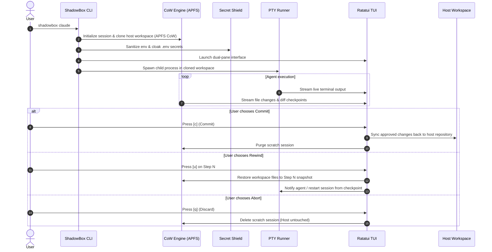

# ShadowBox: Design Specification
**Date:** 2026-10-14  
**Project:** ShadowBox (`shadowbox`)  
**Status:** Approved  
**Author:** Antigravity & User  

---

## 1. Overview & Problem Statement

Autonomous AI coding agents (Claude Code, Cursor Composer, Aider, OpenHands, Goose, etc.) are rapidly becoming the primary method of software development. Developers increasingly want to run agents unattended or with auto-approval flags (`--dangerously-skip-permissions`).

However, developers face a critical operational dilemma:
1. **Destructive Risk:** Agents can run commands that accidentally delete files (`rm -rf`), drop local databases, corrupt Git history, or break system configs.
2. **Data & Secret Leakage:** Autonomous agents can inadvertently read `.env`, AWS credentials, or SSH keys and send them via HTTP to external LLM providers or third-party APIs.
3. **No Granular Rollback:** Existing tools only offer binary choices: either don't run the agent, or run it and hope `git stash` or `git checkout` can clean up the mess (which fails if the agent mutated non-git files, installed global packages, or wiped uncommitted work).

**ShadowBox** is a zero-trust, local-first runtime and time-machine flight recorder designed specifically for autonomous AI coding agents. It wraps any agent command in a lightweight, copy-on-write workspace with real-time secret protection, a live terminal user interface (TUI), and granular, interactive time-travel rollback.

---

## 2. Key Objectives & Success Criteria

1. **Zero-Configuration Instant Safety:**
   - Single binary install: `brew install shadowbox` or `cargo install shadowbox`.
   - Usage: `shadowbox <command...>` (e.g., `shadowbox claude`, `shadowbox aider`).
2. **Zero-Copy Isolation (CoW):**
   - On macOS: Utilizes APFS `clonefile` system calls to create instant (~15ms), zero-disk-overhead copies of the active workspace.
   - On Linux: Utilizes OverlayFS / copy-on-write hardlink fallback.
   - Real repository files remain 100% untouched until the user explicitly commits changes.
3. **Secret Shield & DLP Guard:**
   - Strips or sanitizes sensitive environment variables (`AWS_SECRET_ACCESS_KEY`, `SSH_AUTH_SOCK`, `GITHUB_TOKEN` unless explicitly whitelisted).
   - In-memory masking or isolated stubbing of sensitive root files (`.env`, `.env.local`, `.npmrc`).
4. **Interactive Time-Machine TUI (Ratatui):**
   - Real-time command and file change timeline.
   - Per-step diff visualizer.
   - Instant rewind: jump back to step N to undo bad agent decisions.
   - Atomic commit: apply selected changes back to real repository with one keypress (`[Enter]` / `[c]`).

---

## 3. System Architecture & Components

ShadowBox is implemented in **Rust** as a single high-performance binary with modular architecture:

```
┌─────────────────────────────────────────────────────────────┐
│                      CLI Entrypoint                         │
│             (clap: arguments, flags, subcommands)           │
└──────────────────────────────┬──────────────────────────────┘
                               │
       ┌───────────────────────┼───────────────────────┐
       ▼                       ▼                       ▼
┌──────────────┐       ┌──────────────┐       ┌─────────────────┐
│ Session CoW  │       │ PTY Process  │       │  Secret Shield  │
│   Engine     │       │   Runner     │       │  & DLP Guard    │
│ (APFS Clone) │       │ (portable-   │       │ (Env & File     │
│              │       │    pty)      │       │    Sanitizer)   │
└──────┬───────┘       └──────┬───────┘       └────────┬────────┘
       │                      │                        │
       └──────────────────────┼────────────────────────┘
                              ▼
               ┌──────────────────────────────┐
               │    Diff Engine & Watcher     │
               │      (notify + similar)      │
               └──────────────┬───────────────┘
                              ▼
               ┌──────────────────────────────┐
               │      TUI & Time-Machine      │
               │     (ratatui + crossterm)    │
               │  • Timeline & Step Browser   │
               │  • Split Diff & PTY View     │
               │  • Rewind / Commit / Abort   │
               └──────────────────────────────┘
```

### 3.1. `SessionManager` & CoW Filesystem Engine (`src/session/`)
* **Session Directory:** Stored under `.shadowbox/sessions/<timestamp>-<nanos>/`.
* **APFS Clone:**
  - Uses `libc::clonefile()` on macOS with `CLONE_NOFOLLOW` / `CLONE_NOOWNERCOPY`.
  - For each tracked file/directory in the source workspace, an APFS CoW link is created. Writes by the child process allocate new blocks only for modified data; unmodified files share storage blocks with the host.
* **Session Manifest:** A lightweight JSON record (`session.json`) tracking start time, target command, base commit hash, and list of checkpoints.

### 3.2. `SecretShield` (`src/shield/`)
* **Environment Sanitization:**
  - Filters out high-risk environment variables before passing environment to the child process (`SSH_KEY*`, `AWS_*`, `GOOGLE_APPLICATION_CREDENTIALS`, custom user patterns).
* **Sensitive File Cloaking:**
  - Detects `.env*` files in the workspace.
  - Option to replace them with `.env.example` or dummy placeholder values in the sandbox copy to prevent exfiltration by rogue LLM prompts.

### 3.3. `PtyRunner` (`src/runner/`)
* Built with `portable-pty`.
* Allocates a virtual master/slave PTY pair.
* Sets slave PTY terminal size to match the host terminal or TUI pane.
* Pipes stdin from user and captures raw stdout/stderr with timestamped chunking so output can be replayed or displayed in real-time.

### 3.4. `DiffEngine` & Checkpointing (`src/diff/`)
* Uses `notify` (with macOS `FSEvents` / `kqueue`) to track created, modified, and deleted files.
* Produces unified diffs using the `similar` crate.
* Generates discrete `Checkpoint` structs:
  ```rust
  pub struct Checkpoint {
      pub id: usize,
      pub timestamp: std::time::SystemTime,
      pub description: String,
      pub modified_files: Vec<PathBuf>,
      pub diffs: Vec<FileDiff>,
      pub snapshot_dir: PathBuf,
  }
  ```
* Time-travel is achieved by keeping snapshot references: rewinding restores the CoW working directory to the exact file state of that checkpoint.

### 3.5. `TuiApp` (`src/tui/`)
* Built using `ratatui` and `crossterm`.
* **Dual-Pane Layout:**
  - **Left Pane (30%):** Step Timeline (e.g. `Step 1: Agent started`, `Step 2: Created api.ts (+45)`, `Step 3: Modified package.json (+1, -0)`).
  - **Right Pane (70%):** Tabbed View:
    - Tab 1: Live Terminal PTY stream.
    - Tab 2: Unified Diff viewer for selected step/files.
    - Tab 3: Security & Secret Shield Audit Log.
  - **Bottom Bar:** Status indicators & shortcuts:
    - `[Tab]` Switch panes
    - `[↑/↓]` Select step
    - `[u]` Undo / Rewind to step
    - `[c]` Commit changes to host workspace
    - `[q]` Abort & discard session without changes

---

## 4. Execution Flow & Lifecycle



---

## 5. Security & Error Handling

1. **APFS Fallback:** If the filesystem is not APFS (e.g., external ext4/FAT drive or Linux), fall back to hardlink trees or fast atomic copying with a clear log indicator.
2. **Process Signals (SIGINT / SIGTERM):** Intercepting `Ctrl+C` in the TUI pops up a confirmation modal: `[A]bort and Discard`, `[C]ommit so far`, or `[R]esume`. The child process is killed cleanly with `SIGTERM` followed by `SIGKILL` if unresponsive.
3. **Storage Hygiene:** Session scratchpads are stored in `.shadowbox/sessions/`. A command `shadowbox clean` automatically purges sessions older than 24 hours.

---

## 6. Testing & Quality Assurance Plan

1. **Unit Tests:**
   - `test_cow_clone`: Verifies APFS zero-copy file creation and modification isolation.
   - `test_secret_shield`: Verifies environment variable filtering and `.env` protection.
   - `test_diff_calculation`: Verifies accurate unified diff generation between snapshots.
2. **Integration Tests:**
   - E2E test launching a mock script that writes files and deletes a file. Verifying that:
     1. Host files remain unchanged while session is active.
     2. Committing applies exact changes to the host.
     3. Aborting leaves host 100% pristine.
3. **Verification Command:**
   - `cargo test --all` must pass with 0 warnings.
